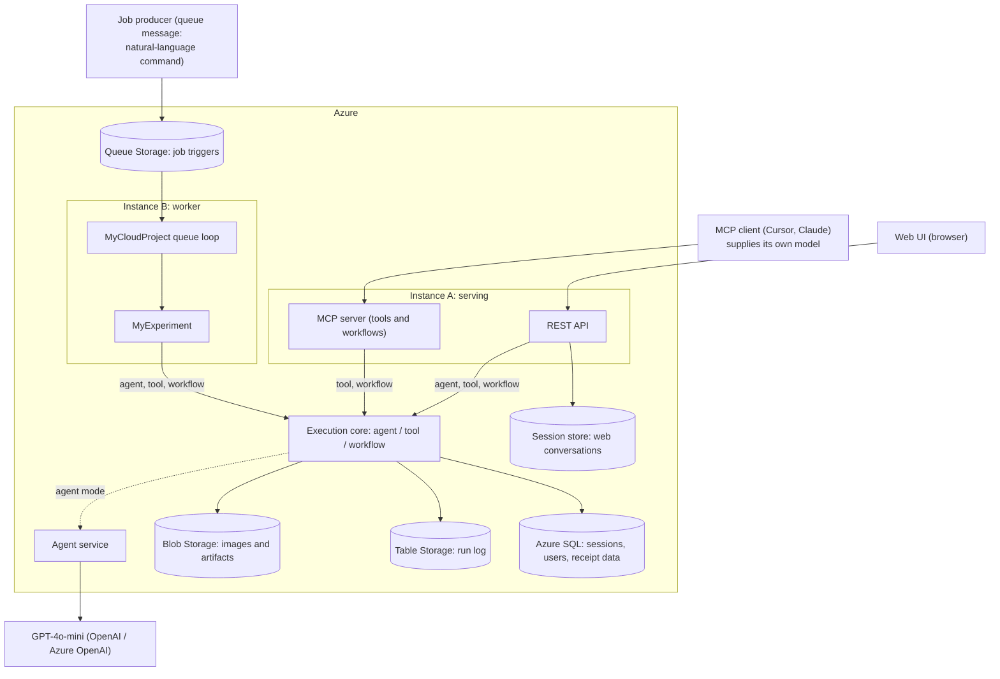

# Cloud Project Plan (v1.2)

Cloud-Native AI Preprocessing Agent for OCR, Cloud Computing phase.

This plan supersedes `CLOUD_PROJECT_PLAN.md` (queue-first) and `CLOUD_PROJECT_PLAN_MCP_FIRST.md` (v0.2). Both files stay in the repository for history and are marked as superseded. This document is the single source of truth.

The plan is organised by phase, not by date. Each phase ends in something that runs and can be demonstrated. The order is chosen so that the parts we understand least are proven before anything is built on top of them.

Superseded material is struck through and folded into a blockquote rather than deleted, so a decision can be reread and reversed later. Nothing that was once planned is removed from this file.

**What changed in v1.1.** Phase 6 was rewritten a second time and the phase order is unchanged. The `agent_chat` MCP tool is dropped: an MCP client already supplies its own model, so a tool hiding a weaker one behind it bills two models for one turn, hides the tool trace from the client, and returns a single blob where the client would otherwise stream. Phase 6 keeps the MCP work that removing it exposed — stateless transport, server-supplied instructions, workflow progress notifications, and a reference-resolution defect the session design would never have fixed — and adds the natural-language agent as a callable service. Session persistence moves to Phase 7, where the Web UI is its first real consumer, and its backing store is chosen there rather than fixed in advance. Phase 9 gains the detail that a queue message is itself a natural-language command, which is why the agent service is extracted early enough for the worker to reuse it.

**What changed in v1.2.** Phase 7 is complete. React, Vite, and TypeScript provide the same-origin
Web UI; ASP.NET exposes REST and SSE over the existing serving process; Azure SQL now holds durable
agent sessions, user profiles, structured receipts, and line items. Anonymous use is complete and
Microsoft login is implemented but awaits the tenant administrator's app registration. Vector search
is removed from Phase 8 implementation scope and retained as future work; the phase order is unchanged.

~~**What changed in v1.3.** Phase 9 is complete. The unchanged course host now runs as a separate
no-ingress Container App, while `MyExperiment` adapts versioned queue descriptors to the shared
agent/tool/workflow execution core. Real Azure acceptance produced durable result rows and 5, 5, and
18 result artifacts for the agent, tool, and workflow samples respectively.~~

**What changed in v1.4.** Phase 9 was simplified to the course template's natural shape. A queue
message is now a plain-language agent command, not a JSON descriptor. The worker resolves the named
image from `training-files`, reuses `AgentService`, and keys Blob/Table results by the OCR run ID.

## 1. Status and Scope

### What already works

`OcrAgent` from the Software Engineering course is the processing core and it is unchanged in substance. It registers 28 callable tools across analysis, geometric, enhancement, segmentation, OCR, and extraction categories. `ToolBindingRegistry` invokes any tool by name, and the workflow engine chains tools into deterministic JSON pipelines such as `receipt_extract_v3`. The project targets `net8.0` alone, having dropped `net9.0` in Phase 4 for the container base image, so the .NET 8 question that both earlier plans left open is closed.

Phase 1 of the cloud work is complete. `OcrAgent.Mcp` is a `net8.0` project that hosts the engine in-process and exposes the whole tool surface over the Model Context Protocol on two transports, Streamable HTTP and stdio. A local MCP client can list the tools, register an image, invoke any single plugin, and run `receipt_extract_v3` end to end. There is no queue and no model key in that phase; the connecting client supplies the reasoning. That last point started as a phase boundary and is now the permanent shape of the MCP server, for the reason recorded in section 3.

Phases 2 through 5 are also complete: images and run records live in Azure Storage, the engine runs in a `linux/amd64` container, and that container is deployed as a Container App reachable over HTTPS.

### What this plan covers

Everything between that baseline and a deployed cloud system: Azure Blob for images and artifacts, Azure Table for the run log, a Linux container, deployment to Azure, a stateless MCP server and a reusable natural-language agent service, a REST API and Web UI with durable conversations, Azure SQL for sessions, users, and receipt data, and the course template's queue-triggered path in `MyExperiment`. Vector similarity is future work.

### Constraint from the course guide

The guide states that the work is focused on `MyExperiment` and that `MyCloudProject` and `MyCloudProject.Common` must not be changed. That constrains the queue-worker path only. It does not prevent adding projects to the solution, which `OcrAgent.Mcp` already demonstrates. Every component in this plan is either a new project in the solution or an implementation inside `MyExperiment`.

## 2. Target Architecture

One container image, two running instances. The image carries the engine, the native OCR dependencies, and both entry points. The instance decides which entry point runs.

Both instances run the same execution core over the same storage. The entry point changes, the engine does not. Only two of the three entry points reach the model: a browser and a queue message arrive without one, an MCP client arrives with one already.

| Component | Hosting | Role |
|---|---|---|
| MCP server | Instance A | Remote tool and workflow access for MCP-capable clients, which supply their own model |
| REST API | Instance A | HTTP entry for the Web UI and scripted callers, including agent mode |
| Queue worker | Instance B | Course template path, asynchronous execution of natural-language commands |
| Execution core | Library in both instances | Runs agent, tool, and workflow modes |
| Agent service | Library in both instances | Turns one natural-language command into tool calls; used by REST and the worker, not by MCP |
| Blob Storage | Azure | Input images, intermediate and final artifacts |
| Table Storage | Azure | One row per run |
| Queue Storage | Azure | Job triggers for the worker |
| Session store | Azure SQL | Durable Web UI conversations with optimistic concurrency and idempotency |
| Azure SQL | Azure | Conversations, Microsoft identities, queryable receipts, and line items |
| Key Vault or app settings | Azure | Storage connection string, model key |

## 3. Key Design Decisions

**One execution core, several entry points, once there are three.** A single job entry point takes a mode (agent, tool, or workflow) plus arguments and returns a result. The MCP server, the REST API, and `Experiment.RunAsync` are thin adapters over it. This is what keeps `MyExperiment` small and stops the entry points from drifting apart. Building it is deferred to Phase 9. With only the console and the MCP host written, its shape would be guesswork, and `Experiment.RunAsync` is the caller that gives it a real requirement. What Phase 6 does take from it is the duplicated bootstrap, because that drift is real between the two entry points that already exist. Phase 6 also extracts an agent service, which is not the core either: it is one mode, pulled out early because the REST API in Phase 7 and the worker in Phase 9 both need it and neither should build its own.

**The Blob store is cache-backed, not a pure remote store.** `IImageStore.GetImagePath` returns a filesystem path, and roughly 25 plugin call sites read that path directly with `File.ReadAllBytes`. `AzureBlobImageStore` therefore downloads a blob into a local job-scoped directory and returns that path, then writes through to Blob on save. `SftpImageStore` already solves this the same way, so the pattern is proven in this codebase rather than invented here.

**Store scope becomes per job.** `IImageStore.SetActiveSubdirectory` is mutable state, and the MCP host shares one `PluginAggregator` across requests. That is safe for a single console user and unsafe for concurrent cloud requests. Scoping moves to a per-job store instance in the Blob phase, before anything multi-user is added.

~~**The queue message points at a job descriptor.** `Experiment.RunAsync` receives the path of a file the worker has already downloaded, so the input file is a small JSON descriptor holding the mode and, depending on it, either a natural-language command such as "binarize RCPT001" or the tool or workflow name with its arguments and input image blob name. All three modes travel through the fixed template contract without touching `MyCloudProject`. A message is single-shot, so the descriptor carries no conversation id.~~

**The queue message is the command.** `AzureStorageProvider` exposes the message through the
template's input-file contract, then `Experiment.RunAsync` resolves the image name it contains and
passes the command to the existing one-shot agent. No additional queue protocol is needed.

> Omitted from v1.0: the descriptor was described as "holding the mode, the tool or workflow name, the arguments, and the input image blob name". Still exactly right for tool and workflow modes. Agent mode carries a command instead, and the command names its own image reference.

**The run record is defined in the core.** The core writes a neutral run record to Table Storage. `MyExperiment.ExperimentResult` already implements `ITableEntity` and `IExperimentResult`, so the graded path maps the core's record onto it instead of duplicating the write logic. The Table work done early is reused, not thrown away.

**The model lives where there is no client model.** An MCP client arrives with its own model and its own conversation, so the server owes it tools, workflows, and the guidance to use them well — not a second model. A browser and a queue message arrive with neither, so agent mode serves REST and the worker. That single rule decides where the agent is offered, and it is why `agent_chat` is not an MCP tool: a model placed between two models bills twice, reasons with the weaker of the two, and replaces a tool trace the client could inspect and approve with one opaque blob. MCP is a tool protocol for LLM clients, REST serves the UI, the worker serves the queue, and all three sit on the same engine.

> Omitted from v1.0: "**The Web UI talks to the REST API, not to MCP.** MCP is a tool protocol for LLM clients, with session and streaming semantics that a browser has no reason to speak. MCP stays the interface for LLM clients, REST serves the UI, and both sit on the same core." The conclusion is unchanged and the browser half still holds. The session half no longer describes this system's MCP server, which is stateless from Phase 6 onward, and the rule above is the more general statement it was reaching for.

## 4. Continuous Tracks

Three items do not belong to any phase and start immediately, because they either block later work or are cheap to do early.

- **Storage account access.** Raise the subscription issue now, then create the team's own container, queue, and table in the shared account. The guide forbids touching other entities. Phase 2 cannot start without this.
- **Exercises.** Practise and document all course exercises in `Exercises - Firstname Lastname.md`. This is a graded deliverable with no dependency on the project code.
- **Experiment specification.** Fill in `Experiment Specification - Firstname Lastname.md`. It is a document, the guide notes all groups share the same specification, and it should not wait behind the implementation.

## 5. Phase Plan

### Phase 1: MCP server over the engine (complete)

`OcrAgent.Mcp` hosts `OcrAgent` in-process and exposes `RegisterImage`, all plugin tools, `ListWorkflows`, and `RunWorkflow` over MCP on HTTP and stdio. Verified with a local MCP client across a single tool call and a full `receipt_extract_v3` run against the local image store.

### Phase 2: Azure Blob Storage

**Goal.** Cloud runs read and write images from Blob Storage through the existing `IImageStore` abstraction.

**Work.**
- Implement `AzureBlobImageStore` behind `IImageStore` and register it in `StorageFactory` as a new provider.
- Download on read into a job-scoped local directory and return that path, following the `SftpImageStore` pattern. Write through on `SaveBytes` and `SaveFromFile`, keeping the JSON sidecar alongside the image.
- Map the active subdirectory concept onto a blob name prefix.
- Replace the shared mutable scope with a per-job store scope so concurrent runs cannot overwrite each other.
- Read the connection string and container names from configuration and environment variables. Nothing secret is committed.
- Develop against Azurite first, then switch to the team's real container.

**Acceptance.** A workflow driven from an MCP client takes its input from Blob and writes every intermediate and final artifact to Blob. Two concurrent runs of the same workflow do not collide.

### Phase 3: Azure Table Storage

**Goal.** Every job executed by the system leaves one queryable record.

**Work.**
- Define the run record in the execution core: run id, mode, tool or workflow id, input reference, final output reference, step count, success flag, duration, and error text when it fails. Partition by group id, row key is the run id.
- Write the record from the MCP host after each job, success or failure.
- Add a `get_run` MCP tool that reads a record back by run id. The earlier plans promised this tool and it was never built.

**Acceptance.** Each MCP job produces exactly one Table row, failures included, and `get_run` returns it.

### Phase 4: Linux container

**Goal.** The engine, including OCR, runs in a Linux container. This is the highest technical risk in the project.

**Work.**
- Write the Dockerfile on the .NET 8 ASP.NET base image.
- Install the native dependencies the project does not yet have for Linux: system Tesseract and Leptonica libraries, and an OpenCvSharp Linux runtime package. Today `OcrAgent.csproj` references runtime packages for macOS ARM and Windows only.
- Copy `tessdata`, the U2-Net ONNX model, and the workflow definitions into the image.
- Build one image with both entry points, selected at start-up. The macOS dylib forwarding target stays a local development aid and plays no part here.
- Confirm OCR actually loaded rather than silently degrading. The engine disables `RunOcr` when Tesseract fails to initialise, so the signal is those two tool names being present, not a raw tool count. Phase 3 added `GetRun` and `ListRuns`, which made a fixed count of 28 misleading.

**Acceptance.** The container lists `RunOcr` and `ScoreOcrResult` by name and completes `receipt_extract_v3` against Blob Storage with real OCR text.

### Phase 5: Deploy to Azure (complete)

**Goal.** The system runs in Azure and is reachable from outside.

**Work.**
- Push the image to a container registry with `az acr build --platform linux/amd64`.
- Run one serving instance on Azure Container Apps. The worker instance is deferred to Phase 9; the `worker` role still exits until the queue path exists.
- Supply the storage connection string (and the model key when present) as Container Apps secrets, not image layers.
- Drive the deployed MCP endpoint over HTTPS. Images enter through Blob (`DEPLOY01.jpg` is reference `DEPLOY01`); `RegisterImage` is not used, because it needs a path the server can read.
- Script deploy, stop, start, and teardown. Teardown deletes only the app, the environment, and the registry, never the resource group or the storage account.

**Acceptance.** A local MCP client drives the deployed engine through `receipt_extract_v3`, the OCR text is real text, the artifacts appear in Blob, and the run is queryable in Table. Stop then start returns the same working endpoint.

**Correction made after the fact.** The first deployment took its region from the resource group, East US, while the storage account is in Germany West Central, so every image each workflow step read or wrote crossed regions. `azure-deploy.sh` now places new resources beside the storage account and warns if it finds an environment elsewhere, and the deployment was torn down and rebuilt in Germany West Central. The app's hostname changed with it.

### ~~Phase 6: Execution core and agent chat~~ (superseded)

> Kept for history. Replaced by the revised Phase 6 below for two reasons. The shared execution core was deferred: with only the console and the MCP host written, a three-mode job abstraction would have been designed against two callers and an assumption. The agent chat design was rewritten because conversation state held in the server process cannot survive an app that scales to zero.
>
> **Goal.** One core serves every entry point, and the natural-language agent works in the cloud.
>
> **Work.**
> - Extract the bootstrap that `OcrAgentToolHost` performs into a shared library exposing a single job entry point for the three modes.
> - Add an `agent_chat` MCP tool backed by `AgentRunner` and GPT-4o-mini, with per-session conversation state keyed by a session id so the agent can refer to references it created earlier.
> - Take the model key from configuration, never from the image.
> - Freeze the job descriptor JSON schema in this phase. Phase 9 consumes it unchanged.
>
> **Acceptance.** An MCP client holds a multi-turn conversation that chains several tools, and the same core still serves single-tool and workflow calls.

### ~~Phase 6 (revised): Durable sessions and agent chat~~ (superseded)

> Kept for history. Replaced by Phase 6 (v1.1) below, and most of it is not discarded but relocated. The engineering here is sound; what was wrong was where it was exposed. It put the conversation behind an `agent_chat` MCP tool, which asks a client that already has a model to call a weaker one, pay for both, lose per-tool approval and the intermediate trace, and wait in silence for a single blob because a tool call returns once. Dropping that tool leaves Phase 6 with no consumer for a session store, so the session specification below moves intact to Phase 7 where the Web UI needs it, and its backing store is decided there. The problem statement also needs correcting: once no conversation lives in the MCP process, scale-to-zero costs the MCP server nothing, and a web chat needs durable conversation state whether or not the app scales to zero.
>
> **Goal.** The natural-language agent works in the cloud, and a conversation outlives the replica that started it.
>
> **The problem.** The serving instance runs at min 0 / max 1 replicas, so Container Apps terminates the container after roughly five minutes with no request, and everything in the process heap goes with it. Two kinds of state are affected and they fail differently. The MCP transport session recovers on its own: the next request carries an id the new replica has never seen, the server answers 404, and the protocol has the client re-initialise. A conversation does not recover, because nothing outside the dead process ever knew it existed. A user who runs a workflow, thinks for six minutes, then types "now binarize that one" gets an agent with no idea what "that one" refers to.
>
> **Work.**
> - Set `Stateless = true` on the MCP HTTP transport. The server then keeps nothing between requests, which also removes the session affinity that silently caps the app at one replica. Legacy SSE is incompatible with stateless mode and is not used here.
> - Make the conversation id explicit in the tool contract, since nothing implicit carries it once the transport is stateless. `agent_chat(message, sessionId?)` mints an id on the first call and returns it for the caller to pass back. Phase 7's REST endpoint needs the same contract, so both entry points share it without a shared core.
> - Add `ISessionStore` beside `IRunStore`, under the same two rules: a `NullSessionStore` so a checkout with no configuration still runs, and a bookkeeping failure that never fails the turn which produced the answer.
> - Persist a session as metadata plus payload. A row in a new `OcrSessions` table holds `SessionId`, `CreatedUtc`, `LastActiveUtc`, `TurnCount`, `Title`, `PayloadBlob`, `PayloadETag`, and `SchemaVersion`, partitioned by group id and keyed by the `{ticksDescending:D19}_{sessionId}` form the run store already uses, which lists newest first without sorting and keeps a lookup a point read. The conversation goes to `sessions/{sessionId}.json` as the `JsonElement` from `AIAgent.SerializeSessionAsync`, restored through `DeserializeSessionAsync`. Session ids come from the existing `RunId` generator.
> - Write the payload with `If-Match` on the stored ETag, so two turns racing on one session produce a 412 and a re-read instead of one overwriting the other unnoticed.
> - Record the caller's turn id and return the stored answer when it repeats. MCP clients retry, and a retry must not append the same user message twice.
> - Add `SessionId` to `RunRecord`. One column now, an awkward backfill later, and it is what lets Phase 7 show which artifacts a conversation produced.
> - Bound the payload. Every turn resends the whole history to the model and a single `RunOcr` result is a large JSON document, so tool results are referenced through the run record rather than carried inline. `LastActiveUtc` plus a blob lifecycle rule expires abandoned sessions.
> - Take the model key from configuration, never from the image.
> - Fold the duplicated engine bootstrap in `Program.cs` and `OcrAgentToolHost` into one `EngineHost.Create()`. This is de-duplication, not the deferred core: no modes, no job descriptor. The two copies have already drifted, and one of the differences means `appsettings.{DOTNET_ENVIRONMENT}.json` is read by the console and ignored by the MCP host.
>
> **Storage choice.** Sessions live on Blob and Table rather than Azure SQL, even though Phase 8 brings SQL in. A session is fetched by id, never joined and never queried by content, which is what Table Storage is best at and where SQL would add nothing. The cost shapes also disagree: the container is scale-to-zero while SQL bills continuously, and serverless auto-pause would put a database resume of thirty to sixty seconds in front of the first message after an idle period, which is the exact flow this phase exists to fix. Keeping sessions on the shared storage account also keeps the graded path independent of the team subscription, which section 6 asks for. Redis is the usual answer for this pattern and is left out for the same cost reason; its millisecond advantage is invisible behind a model call measured in seconds.
>
> **Not in this phase.** The shared execution core and the frozen job descriptor move to Phase 9, where `Experiment.RunAsync` becomes the third caller and can shape them against a real requirement.
>
> **Acceptance.** A multi-turn conversation continues correctly across a replica that has scaled to zero and cold-started, and across a deployment. Two turns issued concurrently on one session leave the history consistent. Every run recorded during a conversation carries its session id.

### Phase 6 (v1.1): Stateless MCP server and the agent service

**Goal.** The MCP server is protocol-current, holds nothing between requests, and hands a calling model everything it needs to drive the engine well. The natural-language agent becomes a callable service with no network entry point of its own yet.

**Why the agent is not an MCP tool.** MCP divides responsibility so that the client owns the model and the server owns the capabilities. `OcrAgentToolHost.CreateMcpTools` already publishes every `AIFunction` with the JSON schema generated from its `[Description]` attributes, which is what lets a client plan and chain correctly, and one tool taking a free-text message would tell that client far less than thirty typed ones do. The guidance such a tool was meant to carry has a protocol slot of its own, and this phase puts it there instead.

**Work.**

- Upgrade the SDKs first, because later decisions in this phase and the next depend on what they contain. `ModelContextProtocol` and `ModelContextProtocol.AspNetCore` go from 1.4.1 to the 2.x line, where stateless is the default rather than an override and the stateful-only surface carries deprecation diagnostics. `Microsoft.Agents.AI` and its OpenAI and Workflows packages go from `1.0.0-rc4` to the stable release; the session design in Phase 7 assumes an `AIAgent` session-serialization surface that the pinned release candidate may not expose, and a graded submission should not ship on release candidates in any case. The deployed MCP endpoint and `verify-deployment.sh` are the regression test.
- Set the HTTP transport to stateless. The server then keeps nothing between requests, which also removes the session affinity that silently caps the app at one replica, so `azure-start.sh` can raise the maximum above one. Legacy SSE is incompatible with stateless mode and is not used here. The justification is no longer only operational: protocol revision `2026-07-28` removed `Mcp-Session-Id` from Streamable HTTP altogether, so stateless is the forward-compatible configuration rather than a workaround for scale-to-zero.
- Populate `McpServerOptions.ServerInstructions` from the instructions currently written inline in `AgentRunner.CreateAgent`. They are sent in the `initialize` response and clients use them as a system message, so the rules the console agent has always had reach the calling model instead of being guessed from schemas that cannot express them: call `RunWorkflow` once rather than stepping through tools by hand, feed each tool's output reference into the next call instead of reusing the original, run `AssessQuality` first and carry the profile forward, and what to leave out of a workflow summary. Extract the text into one shared constant so the console agent and the MCP server cannot drift, and verify the connected client actually surfaces it, since support varies by client.
- Report workflow progress. `WorkflowRunner.RunAsync` already consumes a stream of `StepCompletedEvent` from `InProcessExecution.RunStreamingAsync` and folds it into the final result; that stream is the progress feed, and a nine-step `receipt_extract_v3` becomes nine notifications. Progress notifications are sent inline as part of the response to the client's own request rather than unsolicited, so they survive stateless mode where resource subscriptions and tool-list-changed notifications do not. This is more visibility than an `agent_chat` tool could have offered, not less.
- Fix workflow-scoped reference resolution. `WorkflowRunner` scopes a run to `wf_<id>/<runId>/` and clears the scope in its `finally` block, while the store resolves a reference against the active scope and then the container root. A reference a workflow produced is therefore unresolvable by the next standalone tool call — not after a cold start, but immediately, in the same warm process. This is the real defect behind "run the workflow, then binarize step four", and durable sessions would not have fixed it because the scope was never in the conversation either. `RunRecord.OutputDirectory` already records the scope, so most of an index exists; the mechanism is settled in this phase's planning.
- Add a small set of MCP prompts for the flows worth naming, such as preprocessing a receipt end to end. Prompts are the protocol's mechanism for server-supplied templates a user invokes deliberately, where `ServerInstructions` is the always-on guidance, and they add a second MCP capability beyond tools.
- Add an `AgentService` in `OcrAgent`: one natural-language command in, the model's tool calls executed against the existing surface, the answer and the run records out. `AgentRunner`'s console loop is rewritten as a thin caller of it, so the service is exercised by a working caller in this phase rather than designed against an assumption. It gains no HTTP entry point here. Phase 7 puts REST in front of it and Phase 9 calls it from the worker, so both share one implementation without waiting for the execution core.
- Take the model key from configuration, never from the image.
- Fold the duplicated engine bootstrap in `Program.cs` and `OcrAgentToolHost` into one `EngineHost.Create()`. This is de-duplication, not the deferred core: no modes, no job descriptor. The two copies have already drifted, and one of the differences means `appsettings.{DOTNET_ENVIRONMENT}.json` is read by the console and ignored by the MCP host.
- Add `ConversationId` to `RunRecord`. One column now, an awkward backfill later, and it is what lets Phase 7 show which artifacts a conversation produced.

**Not in this phase.** Session persistence, and with it the whole `ISessionStore` specification in the superseded Phase 6 above, moves to Phase 7 where the Web UI is the first caller that needs a conversation to outlive a request. Nothing in this phase holds conversation state, so nothing in it is exposed to scale-to-zero. The shared execution core and the job descriptor stay in Phase 9.

**Acceptance.** A connected MCP client lists the tool surface with the server's instructions applied, and completes `receipt_extract_v3` while reporting step progress. A reference produced by a workflow is usable in the next standalone tool call, both in a warm process and after a cold start. Two clients drive the deployed app concurrently with the replica maximum above one and no session affinity. The console chat still works, now driven through the agent service that Phase 7 and Phase 9 will call.

### Phase 7: REST API, Web UI, Azure SQL, and durable conversations (complete)

**Goal.** A browser user can use the system without an MCP client, and a conversation outlives the request and the replica that started it.

**Work.**
- Add an ASP.NET API to the serving instance: submit a job in any mode, fetch a run, list workflows, retrieve an artifact.
- Put the agent behind REST. This is where the model belongs, because a browser arrives without one. `AgentService` from Phase 6 is the implementation, so this phase adds only the conversation contract: post a message to a conversation, stream the answer back over SSE so the user sees model output and workflow steps as they happen instead of waiting out a workflow in silence. A conversation id is explicit in the contract and minted on the first message.
- Design and build the session store. The specification in the superseded Phase 6 above is the starting point and its individual decisions still hold: a null implementation so a checkout with no configuration still runs; bookkeeping that never fails the turn which produced the answer; metadata separate from payload; optimistic concurrency so two racing turns cannot silently overwrite one another; an idempotency key per turn so a client retry does not append the same user message twice; tool results referenced through the run record rather than carried inline, because a single `RunOcr` result is a large JSON document and every turn resends the whole history; and a last-active timestamp plus a lifecycle rule to expire abandoned conversations.
- Choose the backing store here rather than in advance. The superseded phase argued for Blob and Table on access-shape and cost grounds, and that reasoning is still on the table and still good. What changes is that Azure SQL arrives in Phase 8 anyway, and a relational store becomes reasonable if this phase also takes on accounts and sign-in, which a multi-user Web UI may want. Whether user management is in scope, and which store follows from that, is decided in this phase's own planning with the UI requirements in hand.
- Build the Web UI with a chat panel over the conversation endpoint and an upload-and-run panel for workflows, plus run history from Table Storage and an artifact viewer.
- The UI calls the REST API only.
- Prefer a UI that keeps nothing in the server process. Blazor Server holds a per-user circuit in the replica and would reintroduce, as a browser session, exactly the scale-to-zero exposure Phase 6 removed from MCP. Static assets served by the same app, hand-written or WebAssembly, keep transient state in the browser and durable state in the session store, and avoid a second deployment and any CORS configuration.

**Acceptance.** A receipt is processed end to end from the browser through both panels, and the run appears in the history view. A multi-turn conversation continues correctly across a replica that has scaled to zero and cold-started, and across a deployment. Two turns issued concurrently on one conversation leave the history consistent. Every run recorded during a conversation carries its conversation id.

**Implemented.** The serving host now maps `/api/*`, MCP, and the compiled React SPA on one origin.
Agent turns stream `token`, `tool`, and workflow `step` events over SSE. Azure SQL Basic stores users,
conversation metadata and serialized `AgentSession` payloads, idempotency rows, normalized receipt
fields and line items, while raw receipt JSON preserves the full extraction. SQL `rowversion` rejects
racing turns without corrupting history. Anonymous conversation ids survive reloads in `localStorage`
and can be claimed after Microsoft login. The deployed app runs min 1 / max 3 replicas.

> Superseded operational wording from the acceptance above: ~~A multi-turn conversation continues
> correctly across a replica that has scaled to zero and cold-started~~. The durability requirement
> remains proven across deployment and replica boundaries, but Phase 7 deliberately keeps one replica
> live for the final submission.

### ~~Phase 8: Azure SQL and vector search~~ (SQL moved to Phase 7; vectors deferred)

> **Goal.** ~~Extracted receipt data is queryable across runs.~~ Completed in Phase 7.

> **Work.**
> - ~~Define the schema for `ReceiptData`: merchant, date, line items, totals, validation state, run id.~~
> - ~~Persist extraction results after a workflow run.~~
> - ~~Add an embedding vector column and implement similarity search and duplicate detection.~~
> - ~~Expose the queries through the REST API and as an MCP tool.~~

> **Acceptance.** ~~Receipts from several runs are queryable by merchant and date range, and similarity
> search returns a near-duplicate receipt.~~ Merchant/date queries are complete. Embeddings, similarity
> search, duplicate detection, and an MCP receipt-query tool are explicitly retained as future work.

### Phase 9: Course template path (complete)

**Goal.** A queue message drives a complete run through the template contracts.

**Why this phase sits late in the order.** The template is shaped for a model-training experiment: one input file, one algorithm, one result row, one score. This project is an interactive preprocessing service, so putting it through that contract is adaptation work rather than discovery, and adaptation is cheapest once there is something finished to adapt. Everything the phase needs — Blob and Table, the container, the deployment, the agent service, the three execution modes — is proven by the phases ahead of it, and none of those phases has to distort itself to fit a contract it does not share. The guide requires the path regardless, so it ships, and section 6 records the exposure that leaving it late creates.

**The queue message is a natural-language command.** A message carries what a user would type at the agent: "binarize RCPT001", "remove the background of RCPT002". `Experiment.RunAsync` hands it to the `AgentService` from Phase 6, the model selects and chains the tools, and the artifacts and the run record land exactly where a REST or MCP job's would. ~~Tool and workflow modes stay available for deterministic messages. Each message is single-shot — one message, one run, no continuity — so the session store from Phase 7 plays no part here and the descriptor carries no conversation id.~~ Every queue message uses the same one-shot agent path; the command may ask that agent to invoke a specific tool or workflow. There is no conversation continuity or descriptor. The template's contract is satisfied by reusing components, not by writing a second engine behind it.

**Work.**
- Implement `AzureStorageProvider` fully: receive and deserialise the queue message, download the input file, upload result files to Blob, write the result row to Table, delete the message on completion.
- ~~Define the job descriptor schema here, where `Experiment.RunAsync` reads it, rather than guessing at it in Phase 6. It carries the mode; for agent mode, the natural-language message, which names its own image reference; for tool and workflow modes, the tool or workflow name with its arguments and the input image blob name. All three modes travel through the fixed template contract.~~ Use the raw queue message as the template input.
- Extract the shared execution core, deferred from Phase 6. This is the third entry point, so the abstraction now has three real callers instead of two and an assumption. Phase 6 already reduced the engine bootstrap to one `EngineHost.Create()` and extracted the agent service, and Phase 7 has already put a second caller in front of that service, which is what this builds on.
- ~~Implement `Experiment.RunAsync` to parse the downloaded job descriptor, call the execution core, and map the core's result onto `ExperimentResult`, including output file references and duration.~~ Keep `Experiment.RunAsync` as a small adapter from one command to `AgentService`, with the primary run ID as the result key.
- Handle a missing model key as a recorded failure row rather than a crashed worker. The simplified queue path always uses `AgentService`, so successful command execution requires `OPENAI_API_KEY`.
- Run the worker instance against the real queue.
- ~~Commit `SampleFiles` with test images and one example message per mode.~~ Commit one test image and document plain-language queue examples.
- Leave `MyCloudProject` and `MyCloudProject.Common` untouched.

**Acceptance.** Plain queue commands for a single tool and a workflow resolve their referenced image,
produce artifacts in Blob, and write run-ID-keyed rows in Table.

~~**Acceptance evidence (v1.3).** `ca-ocr-worker` runs the shared image with no ingress and one
replica. The real-Azure verifier committed all three descriptor-based messages, found successful
fixed-ID rows, and verified their result blobs.~~

**Acceptance evidence (v1.4).** The real-Azure verifier posted the two plain commands above.
Run `01a02e06-12e1-7000-8549-627c0837e8ed` published the background-removal image and sidecar, and
run `01a02e06-38a7-7000-8365-19b16d5dde31` published seventeen receipt-workflow artifacts. Both
run-ID-keyed Table rows succeeded and every referenced result blob exists.

### Phase 10: Hardening, documentation, demo

**Goal.** The project is reviewable and reproducible.

**Work.**
- Structured logging, error handling, and basic monitoring across both instances.
- Cloud README with the architecture diagram and reproduction steps.
- Screenshots of the queue, container, table, and SQL.
- Finish the exercise and specification documents from the continuous tracks.
- Record the demo and raise the review request issue.

**Acceptance.** A reader can reproduce the deployment from the documentation, and the submission is complete.

## 6. Risks

**Linux OCR is unproven.** There is no Dockerfile yet and no Linux OpenCV runtime package in the project. The Tesseract wrapper also needs system libraries present in the image. Phase 4 exists to settle this before deployment, the API, or the UI depend on it. The failure mode is quiet, since the engine drops `RunOcr` instead of crashing, so the tool count is checked explicitly.

**The image store leaks filesystem paths.** Plugins read from disk, so a pure remote store is not possible without touching every plugin. Handled by the cache-backed design in Phase 2, with `SftpImageStore` as the working precedent.

**Shared mutable state under concurrency.** The single `PluginAggregator` and its store scope are safe for one user and unsafe for many. Fixed in Phase 2 rather than left to hardening.

**Azure resources beyond the shared account.** The course provides a shared storage account for the container, queue, and table. Azure SQL, container hosting, Key Vault, and the model endpoint need the team's own subscription and may hit quota or cost limits. The graded path depends only on the shared storage account, so a shortfall in the team subscription cannot take the required deliverable down with it.

**The graded path runs last.** Phase 9 is the deliverable the course explicitly requires, and it is scheduled after the additive work. Four things reduce the exposure: the specification document and storage entities are done in the continuous tracks, the Table write logic is already built and reused from Phase 3, Phase 6 leaves the engine bootstrap de-duplicated so the adapter has one thing to call, and the agent service that `Experiment.RunAsync` needs for natural-language messages is built in Phase 6 and already has a second caller in front of it from Phase 7. ~~The job descriptor schema is defined in Phase 9 itself rather than frozen ahead of it, which accepts a little rework in exchange for a schema shaped by the consumer that actually reads it.~~ The queue message itself is now the command, which removes that schema entirely.

**Two SDK upgrades land in one phase.** Phase 6 moves `ModelContextProtocol` from 1.4.1 to the 2.x line and `Microsoft.Agents.AI` off `1.0.0-rc4`. The MCP jump changes the transport default and deprecates the stateful-only surface; the agent jump crosses a release-candidate boundary, and the session-serialization surface the Phase 7 design assumes may have moved. Both are done at the start of Phase 6 rather than discovered inside Phase 7, and the deployed endpoint plus `verify-deployment.sh` are the regression test. Staying on a release candidate is the alternative risk, and it is the worse one for a graded submission.

**Agent mode in the graded path depends on a personal model key.** Phase 9's acceptance includes a natural-language message, and the model key belongs to the team rather than to the course's shared storage account. Handled by making a missing key a recorded failure rather than a worker crash, so the required evidence rests on the workflow and tool messages, which need no model at all.

## 7. Deliverables

### Required by the course

- `Experiment Specification - Firstname Lastname.md`
- `Exercises - Firstname Lastname.md`
- `MyExperiment` implementing `IExperiment`, with `AzureStorageProvider` implementing `IStorageProvider`
- Queue-triggered run producing Blob artifacts and a Table row, driven by a natural-language command
- `SampleFiles` with test inputs and example queue messages
- Cloud README with architecture and reproduction steps
- `MyCloudProject` and `MyCloudProject.Common` unmodified

### Added by this project

- Stateless MCP server exposing the full tool surface, workflows, workflow progress notifications, server-supplied usage instructions, prompt templates, and run lookup
- `AzureBlobImageStore` behind the existing `IImageStore` abstraction
- Reusable agent service turning one natural-language command into tool calls, shared by the REST API and the queue worker
- Durable agent conversations behind the REST API, so a conversation survives the replica that started it
- Shared execution core covering agent, tool, and workflow modes (Phase 9)
- Linux container image and Azure deployment for both instances
- REST API and Web UI with streaming chat and upload-and-run panels
- Azure SQL store for durable conversations, users, structured receipts, and line items
- Future work: receipt embeddings, vector similarity, and duplicate detection

> Omitted from v1.0: "MCP server exposing the full tool surface, workflows, agent chat, and run lookup" and "Durable agent conversations on Blob and Table, so a session survives the replica that started it". Agent chat is no longer an MCP capability, and the store backing conversations is chosen in Phase 7 rather than named here.
