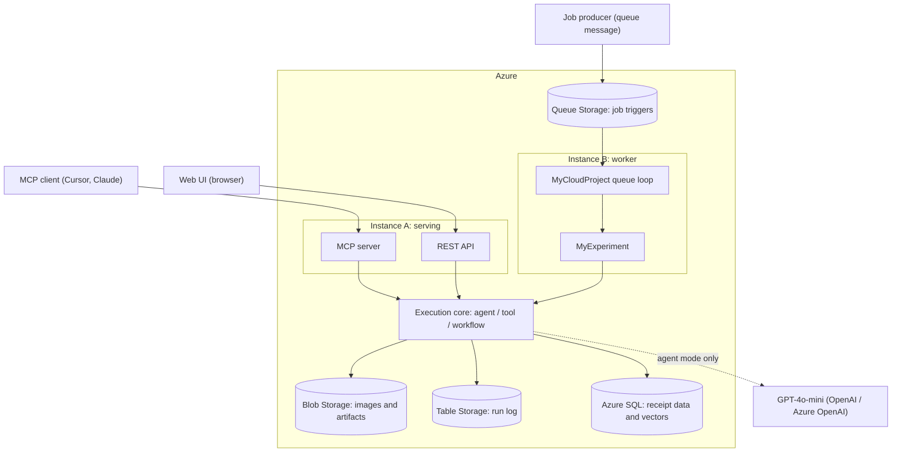

# Cloud Project Plan (v1.0)

Cloud-Native AI Preprocessing Agent for OCR, Cloud Computing phase.

This plan supersedes `CLOUD_PROJECT_PLAN.md` (queue-first) and `CLOUD_PROJECT_PLAN_MCP_FIRST.md` (v0.2). Both files stay in the repository for history and are marked as superseded. This document is the single source of truth.

The plan is organised by phase, not by date. Each phase ends in something that runs and can be demonstrated. The order is chosen so that the parts we understand least are proven before anything is built on top of them.

## 1. Status and Scope

### What already works

`OcrAgent` from the Software Engineering course is the processing core and it is unchanged in substance. It registers 28 callable tools across analysis, geometric, enhancement, segmentation, OCR, and extraction categories. `ToolBindingRegistry` invokes any tool by name, and the workflow engine chains tools into deterministic JSON pipelines such as `receipt_extract_v3`. The project targets `net8.0` alone, having dropped `net9.0` in Phase 4 for the container base image, so the .NET 8 question that both earlier plans left open is closed.

Phase 1 of the cloud work is complete. `OcrAgent.Mcp` is a `net8.0` project that hosts the engine in-process and exposes the whole tool surface over the Model Context Protocol on two transports, Streamable HTTP and stdio. A local MCP client can list the tools, register an image, invoke any single plugin, and run `receipt_extract_v3` end to end. There is no queue and no model key in that phase; the connecting client supplies the reasoning.

Phases 2 through 5 are also complete: images and run records live in Azure Storage, the engine runs in a `linux/amd64` container, and that container is deployed as a Container App reachable over HTTPS.

### What this plan covers

Everything between that baseline and a deployed cloud system: Azure Blob for images and artifacts, Azure Table for the run log, a Linux container, deployment to Azure, a shared execution core with natural-language agent chat, a REST API and Web UI, Azure SQL with vector search, and the course template's queue-triggered path in `MyExperiment`.

### Constraint from the course guide

The guide states that the work is focused on `MyExperiment` and that `MyCloudProject` and `MyCloudProject.Common` must not be changed. That constrains the queue-worker path only. It does not prevent adding projects to the solution, which `OcrAgent.Mcp` already demonstrates. Every component in this plan is either a new project in the solution or an implementation inside `MyExperiment`.

## 2. Target Architecture

One container image, two running instances. The image carries the engine, the native OCR dependencies, and both entry points. The instance decides which entry point runs.

Both instances run the same execution core over the same storage. The entry point changes, the engine does not.

| Component | Hosting | Role |
|---|---|---|
| MCP server | Instance A | Remote tool access for MCP-capable clients |
| REST API | Instance A | HTTP entry for the Web UI and scripted callers |
| Queue worker | Instance B | Course template path, asynchronous execution |
| Execution core | Library in both instances | Runs agent, tool, and workflow modes |
| Blob Storage | Azure | Input images, intermediate and final artifacts |
| Table Storage | Azure | One row per run |
| Queue Storage | Azure | Job triggers for the worker |
| Azure SQL | Azure | Queryable receipt data and vector similarity |
| Key Vault or app settings | Azure | Storage connection string, model key |

## 3. Key Design Decisions

**One execution core, several entry points, once there are three.** A single job entry point takes a mode (agent, tool, or workflow) plus arguments and returns a result. The MCP server, the REST API, and `Experiment.RunAsync` are thin adapters over it. This is what keeps `MyExperiment` small and stops the entry points from drifting apart. Building it is deferred to Phase 9. With only the console and the MCP host written, its shape would be guesswork, and `Experiment.RunAsync` is the caller that gives it a real requirement. What Phase 6 does take from it is the duplicated bootstrap, because that drift is real between the two entry points that already exist.

**The Blob store is cache-backed, not a pure remote store.** `IImageStore.GetImagePath` returns a filesystem path, and roughly 25 plugin call sites read that path directly with `File.ReadAllBytes`. `AzureBlobImageStore` therefore downloads a blob into a local job-scoped directory and returns that path, then writes through to Blob on save. `SftpImageStore` already solves this the same way, so the pattern is proven in this codebase rather than invented here.

**Store scope becomes per job.** `IImageStore.SetActiveSubdirectory` is mutable state, and the MCP host shares one `PluginAggregator` across requests. That is safe for a single console user and unsafe for concurrent cloud requests. Scoping moves to a per-job store instance in the Blob phase, before anything multi-user is added.

**The queue message points at a job descriptor.** `Experiment.RunAsync` receives the path of a file the worker has already downloaded, so the input file is a small JSON descriptor holding the mode, the tool or workflow name, the arguments, and the input image blob name. All three modes travel through the fixed template contract without touching `MyCloudProject`.

**The run record is defined in the core.** The core writes a neutral run record to Table Storage. `MyExperiment.ExperimentResult` already implements `ITableEntity` and `IExperimentResult`, so the graded path maps the core's record onto it instead of duplicating the write logic. The Table work done early is reused, not thrown away.

**The Web UI talks to the REST API, not to MCP.** MCP is a tool protocol for LLM clients, with session and streaming semantics that a browser has no reason to speak. MCP stays the interface for LLM clients, REST serves the UI, and both sit on the same core.

## 4. Continuous Tracks

Three items do not belong to any phase and start immediately, because they either block later work or are cheap to do early.

- **Storage account access.** Raise the subscription issue now, then create the team's own container, queue, and table in the shared account. The guide forbids touching other entities. Phase 2 cannot start without this.
- **Exercises.** Practise and document all course exercises in `Exercises - Firstname Lastname.md`. This is a graded deliverable with no dependency on the project code.
- **Experiment specification.** Fill in `Experiment Specification - Firstname Lastname.md`. It is a document, the guide notes all groups share the same specification, and it should not wait behind the implementation.

## 5. Phase Plan

### Phase 1: MCP server over the engine (complete)

`OcrAgent.Mcp` hosts `OcrAgent` in-process and exposes `RegisterImage`, all plugin tools, `ListWorkflows`, and `RunWorkflow` over MCP on HTTP and stdio. Verified with a local MCP client across a single tool call and a full `receipt_extract_v3` run against the local image store.

### Phase 2: Azure Blob Storage

**Goal.** Cloud runs read and write images from Blob Storage through the existing `IImageStore` abstraction.

**Work.**
- Implement `AzureBlobImageStore` behind `IImageStore` and register it in `StorageFactory` as a new provider.
- Download on read into a job-scoped local directory and return that path, following the `SftpImageStore` pattern. Write through on `SaveBytes` and `SaveFromFile`, keeping the JSON sidecar alongside the image.
- Map the active subdirectory concept onto a blob name prefix.
- Replace the shared mutable scope with a per-job store scope so concurrent runs cannot overwrite each other.
- Read the connection string and container names from configuration and environment variables. Nothing secret is committed.
- Develop against Azurite first, then switch to the team's real container.

**Acceptance.** A workflow driven from an MCP client takes its input from Blob and writes every intermediate and final artifact to Blob. Two concurrent runs of the same workflow do not collide.

### Phase 3: Azure Table Storage

**Goal.** Every job executed by the system leaves one queryable record.

**Work.**
- Define the run record in the execution core: run id, mode, tool or workflow id, input reference, final output reference, step count, success flag, duration, and error text when it fails. Partition by group id, row key is the run id.
- Write the record from the MCP host after each job, success or failure.
- Add a `get_run` MCP tool that reads a record back by run id. The earlier plans promised this tool and it was never built.

**Acceptance.** Each MCP job produces exactly one Table row, failures included, and `get_run` returns it.

### Phase 4: Linux container

**Goal.** The engine, including OCR, runs in a Linux container. This is the highest technical risk in the project.

**Work.**
- Write the Dockerfile on the .NET 8 ASP.NET base image.
- Install the native dependencies the project does not yet have for Linux: system Tesseract and Leptonica libraries, and an OpenCvSharp Linux runtime package. Today `OcrAgent.csproj` references runtime packages for macOS ARM and Windows only.
- Copy `tessdata`, the U2-Net ONNX model, and the workflow definitions into the image.
- Build one image with both entry points, selected at start-up. The macOS dylib forwarding target stays a local development aid and plays no part here.
- Confirm OCR actually loaded rather than silently degrading. The engine disables `RunOcr` when Tesseract fails to initialise, so the signal is those two tool names being present, not a raw tool count. Phase 3 added `GetRun` and `ListRuns`, which made a fixed count of 28 misleading.

**Acceptance.** The container lists `RunOcr` and `ScoreOcrResult` by name and completes `receipt_extract_v3` against Blob Storage with real OCR text.

### Phase 5: Deploy to Azure (complete)

**Goal.** The system runs in Azure and is reachable from outside.

**Work.**
- Push the image to a container registry with `az acr build --platform linux/amd64`.
- Run one serving instance on Azure Container Apps. The worker instance is deferred to Phase 9; the `worker` role still exits until the queue path exists.
- Supply the storage connection string (and the model key when present) as Container Apps secrets, not image layers.
- Drive the deployed MCP endpoint over HTTPS. Images enter through Blob (`DEPLOY01.jpg` is reference `DEPLOY01`); `RegisterImage` is not used, because it needs a path the server can read.
- Script deploy, stop, start, and teardown. Teardown deletes only the app, the environment, and the registry, never the resource group or the storage account.

**Acceptance.** A local MCP client drives the deployed engine through `receipt_extract_v3`, the OCR text is real text, the artifacts appear in Blob, and the run is queryable in Table. Stop then start returns the same working endpoint.

**Correction made after the fact.** The first deployment took its region from the resource group, East US, while the storage account is in Germany West Central, so every image each workflow step read or wrote crossed regions. `azure-deploy.sh` now places new resources beside the storage account and warns if it finds an environment elsewhere, and the deployment was torn down and rebuilt in Germany West Central. The app's hostname changed with it.

### ~~Phase 6: Execution core and agent chat~~ (superseded)

> Kept for history. Replaced by the revised Phase 6 below for two reasons. The shared execution core was deferred: with only the console and the MCP host written, a three-mode job abstraction would have been designed against two callers and an assumption. The agent chat design was rewritten because conversation state held in the server process cannot survive an app that scales to zero.
>
> **Goal.** One core serves every entry point, and the natural-language agent works in the cloud.
>
> **Work.**
> - Extract the bootstrap that `OcrAgentToolHost` performs into a shared library exposing a single job entry point for the three modes.
> - Add an `agent_chat` MCP tool backed by `AgentRunner` and GPT-4o-mini, with per-session conversation state keyed by a session id so the agent can refer to references it created earlier.
> - Take the model key from configuration, never from the image.
> - Freeze the job descriptor JSON schema in this phase. Phase 9 consumes it unchanged.
>
> **Acceptance.** An MCP client holds a multi-turn conversation that chains several tools, and the same core still serves single-tool and workflow calls.

### Phase 6 (revised): Durable sessions and agent chat

**Goal.** The natural-language agent works in the cloud, and a conversation outlives the replica that started it.

**The problem.** The serving instance runs at min 0 / max 1 replicas, so Container Apps terminates the container after roughly five minutes with no request, and everything in the process heap goes with it. Two kinds of state are affected and they fail differently. The MCP transport session recovers on its own: the next request carries an id the new replica has never seen, the server answers 404, and the protocol has the client re-initialise. A conversation does not recover, because nothing outside the dead process ever knew it existed. A user who runs a workflow, thinks for six minutes, then types "now binarize that one" gets an agent with no idea what "that one" refers to.

**Work.**
- Set `Stateless = true` on the MCP HTTP transport. The server then keeps nothing between requests, which also removes the session affinity that silently caps the app at one replica. Legacy SSE is incompatible with stateless mode and is not used here.
- Make the conversation id explicit in the tool contract, since nothing implicit carries it once the transport is stateless. `agent_chat(message, sessionId?)` mints an id on the first call and returns it for the caller to pass back. Phase 7's REST endpoint needs the same contract, so both entry points share it without a shared core.
- Add `ISessionStore` beside `IRunStore`, under the same two rules: a `NullSessionStore` so a checkout with no configuration still runs, and a bookkeeping failure that never fails the turn which produced the answer.
- Persist a session as metadata plus payload. A row in a new `OcrSessions` table holds `SessionId`, `CreatedUtc`, `LastActiveUtc`, `TurnCount`, `Title`, `PayloadBlob`, `PayloadETag`, and `SchemaVersion`, partitioned by group id and keyed by the `{ticksDescending:D19}_{sessionId}` form the run store already uses, which lists newest first without sorting and keeps a lookup a point read. The conversation goes to `sessions/{sessionId}.json` as the `JsonElement` from `AIAgent.SerializeSessionAsync`, restored through `DeserializeSessionAsync`. Session ids come from the existing `RunId` generator.
- Write the payload with `If-Match` on the stored ETag, so two turns racing on one session produce a 412 and a re-read instead of one overwriting the other unnoticed.
- Record the caller's turn id and return the stored answer when it repeats. MCP clients retry, and a retry must not append the same user message twice.
- Add `SessionId` to `RunRecord`. One column now, an awkward backfill later, and it is what lets Phase 7 show which artifacts a conversation produced.
- Bound the payload. Every turn resends the whole history to the model and a single `RunOcr` result is a large JSON document, so tool results are referenced through the run record rather than carried inline. `LastActiveUtc` plus a blob lifecycle rule expires abandoned sessions.
- Take the model key from configuration, never from the image.
- Fold the duplicated engine bootstrap in `Program.cs` and `OcrAgentToolHost` into one `EngineHost.Create()`. This is de-duplication, not the deferred core: no modes, no job descriptor. The two copies have already drifted, and one of the differences means `appsettings.{DOTNET_ENVIRONMENT}.json` is read by the console and ignored by the MCP host.

**Storage choice.** Sessions live on Blob and Table rather than Azure SQL, even though Phase 8 brings SQL in. A session is fetched by id, never joined and never queried by content, which is what Table Storage is best at and where SQL would add nothing. The cost shapes also disagree: the container is scale-to-zero while SQL bills continuously, and serverless auto-pause would put a database resume of thirty to sixty seconds in front of the first message after an idle period, which is the exact flow this phase exists to fix. Keeping sessions on the shared storage account also keeps the graded path independent of the team subscription, which section 6 asks for. Redis is the usual answer for this pattern and is left out for the same cost reason; its millisecond advantage is invisible behind a model call measured in seconds.

**Not in this phase.** The shared execution core and the frozen job descriptor move to Phase 9, where `Experiment.RunAsync` becomes the third caller and can shape them against a real requirement.

**Acceptance.** A multi-turn conversation continues correctly across a replica that has scaled to zero and cold-started, and across a deployment. Two turns issued concurrently on one session leave the history consistent. Every run recorded during a conversation carries its session id.

### Phase 7: REST API and Web UI

**Goal.** A browser user can use the system without an MCP client.

**Work.**
- Add an ASP.NET API to the serving instance: submit a job in any mode, fetch a run, list workflows, retrieve an artifact.
- Build the Web UI with a chat panel over `agent_chat` and an upload-and-run panel for workflows, plus run history from Table Storage and an artifact viewer.
- The UI calls the REST API only.

**Acceptance.** A receipt is processed end to end from the browser through both panels, and the run appears in the history view.

### Phase 8: Azure SQL and vector search

**Goal.** Extracted receipt data is queryable across runs.

**Work.**
- Define the schema for `ReceiptData`: merchant, date, line items, totals, validation state, run id.
- Persist extraction results after a workflow run.
- Add an embedding vector column and implement similarity search and duplicate detection.
- Expose the queries through the REST API and as an MCP tool.

**Acceptance.** Receipts from several runs are queryable by merchant and date range, and similarity search returns a near-duplicate receipt.

### Phase 9: Course template path

**Goal.** A queue message drives a complete run through the template contracts.

**Work.**
- Implement `AzureStorageProvider` fully: receive and deserialise the queue message, download the input file, upload result files to Blob, write the result row to Table, delete the message on completion.
- Define the job descriptor schema here, where `Experiment.RunAsync` reads it, rather than guessing at it in Phase 6. It carries the mode, the tool or workflow name, the arguments, and the input image blob name, so all three modes travel through the fixed template contract.
- Extract the shared execution core, deferred from Phase 6. This is the third entry point, so the abstraction now has three real callers instead of two and an assumption. Phase 6 already reduced the engine bootstrap to one `EngineHost.Create()`, which is what this builds on.
- Implement `Experiment.RunAsync` to parse the downloaded job descriptor, call the execution core, and map the core's result onto `ExperimentResult`, including output file references and duration.
- Run the worker instance against the real queue.
- Commit `SampleFiles` with test images and one example message per mode.
- Leave `MyCloudProject` and `MyCloudProject.Common` untouched.

**Acceptance.** A message placed in the team's queue produces artifacts in Blob and a row in Table, for a workflow job, a single-tool job, and an agent command.

### Phase 10: Hardening, documentation, demo

**Goal.** The project is reviewable and reproducible.

**Work.**
- Structured logging, error handling, and basic monitoring across both instances.
- Cloud README with the architecture diagram and reproduction steps.
- Screenshots of the queue, container, table, and SQL.
- Finish the exercise and specification documents from the continuous tracks.
- Record the demo and raise the review request issue.

**Acceptance.** A reader can reproduce the deployment from the documentation, and the submission is complete.

## 6. Risks

**Linux OCR is unproven.** There is no Dockerfile yet and no Linux OpenCV runtime package in the project. The Tesseract wrapper also needs system libraries present in the image. Phase 4 exists to settle this before deployment, the API, or the UI depend on it. The failure mode is quiet, since the engine drops `RunOcr` instead of crashing, so the tool count is checked explicitly.

**The image store leaks filesystem paths.** Plugins read from disk, so a pure remote store is not possible without touching every plugin. Handled by the cache-backed design in Phase 2, with `SftpImageStore` as the working precedent.

**Shared mutable state under concurrency.** The single `PluginAggregator` and its store scope are safe for one user and unsafe for many. Fixed in Phase 2 rather than left to hardening.

**Azure resources beyond the shared account.** The course provides a shared storage account for the container, queue, and table. Azure SQL, container hosting, Key Vault, and the model endpoint need the team's own subscription and may hit quota or cost limits. The graded path depends only on the shared storage account, so a shortfall in the team subscription cannot take the required deliverable down with it.

**The graded path runs last.** Phase 9 is the deliverable the course explicitly requires, and it is scheduled after the additive work. Three things reduce the exposure: the specification document and storage entities are done in the continuous tracks, the Table write logic is already built and reused from Phase 3, and Phase 6 leaves the engine bootstrap de-duplicated so the adapter has one thing to call. The job descriptor schema is now defined in Phase 9 itself rather than frozen ahead of it, which accepts a little rework in exchange for a schema shaped by the consumer that actually reads it.

## 7. Deliverables

### Required by the course

- `Experiment Specification - Firstname Lastname.md`
- `Exercises - Firstname Lastname.md`
- `MyExperiment` implementing `IExperiment`, with `AzureStorageProvider` implementing `IStorageProvider`
- Queue-triggered run producing Blob artifacts and a Table row
- `SampleFiles` with test inputs and example queue messages
- Cloud README with architecture and reproduction steps
- `MyCloudProject` and `MyCloudProject.Common` unmodified

### Added by this project

- MCP server exposing the full tool surface, workflows, agent chat, and run lookup
- `AzureBlobImageStore` behind the existing `IImageStore` abstraction
- Durable agent conversations on Blob and Table, so a session survives the replica that started it
- Shared execution core covering agent, tool, and workflow modes (Phase 9)
- Linux container image and Azure deployment for both instances
- REST API and Web UI with chat and upload-and-run panels
- Azure SQL receipt store with vector similarity search
