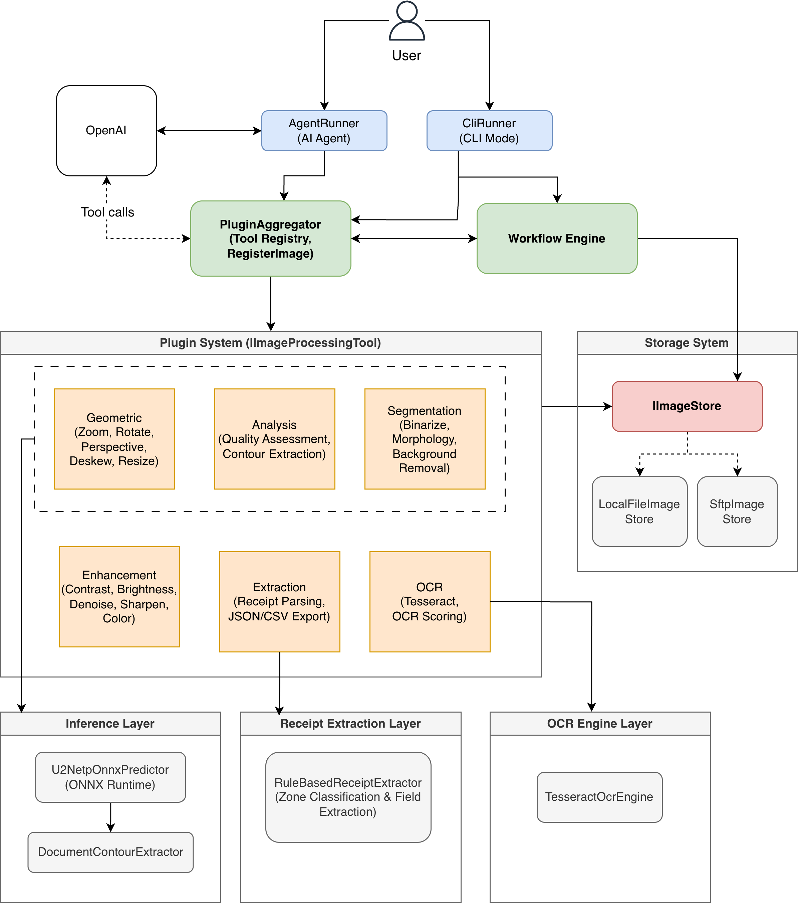

# OcrAgent — AI Preprocessing Agent for Improving OCR Performance

An AI-driven preprocessing system that enhances document images before OCR extraction. Users interact through natural language chat or a deterministic CLI. The system applies image corrections via a plugin-based architecture, runs Tesseract OCR with multi-variant scoring, and extracts structured data from receipts.

## Architecture



For detailed component descriptions, data flow, project structure, and advanced features, see [SYSTEM_ARCHITECTURE.md](SYSTEM_ARCHITECTURE.md).

## Sample Images

The [`samples/`](../samples/) folder contains test receipt photographs for reproducing the results:

- **[receipt-1.jpg](../samples/receipt-1.jpg)** — receipt on fabric background (perspective correction + background removal)
- **[receipt-2.jpg](../samples/receipt-2.jpg)** — straight receipt scan (OCR baseline)
- **[receipt-3.jpg](../samples/receipt-3.jpg)** — angled receipt with shadows (full pipeline test)

Try them with the CLI:

```bash
dotnet run -- wf receipt_extract_v3 ./samples/receipt-1.jpg
dotnet run -- wf receipt_extract_v3 ./samples/receipt-2.jpg
dotnet run -- wf receipt_extract_v3 ./samples/receipt-3.jpg
```

## Prerequisites

- [.NET 9.0 SDK](https://dotnet.microsoft.com/download/dotnet/9.0)
- [Tesseract OCR](https://github.com/tesseract-ocr/tesseract) (for OCR features)
- OpenAI API key (for chat mode only; CLI mode works without it)

### Install Tesseract

**macOS (Homebrew):**

```bash
brew install tesseract
```

The application auto-discovers the Homebrew installation path on macOS arm64. No additional configuration needed.

**Windows:**

1. Download the installer from [UB-Mannheim/tesseract](https://github.com/UB-Mannheim/tesseract/wiki)
2. Run the installer and note the installation path (default: `C:\Program Files\Tesseract-OCR`)
3. Add the installation path to your system `PATH` environment variable
4. Verify: `tesseract --version`

The `Tesseract` NuGet package bundles native libraries for Windows. If the bundled version does not work, set the `Tesseract:TessdataPath` key in `appsettings.json` to point to your tessdata directory:

```json
{
  "Tesseract": {
    "TessdataPath": "C:\\Program Files\\Tesseract-OCR\\tessdata"
  }
}
```

**Linux (apt):**

```bash
sudo apt install tesseract-ocr tesseract-ocr-eng
```

## Setup

### 1. Clone and Build

```bash
cd Source/ML-25-26-01-AI-Preprocessing-Agent-Plugin-for-Improving-OCR-Performance

dotnet restore
dotnet build
```

### 2. Configure Environment

Create a `.env` file in the project root (or set environment variables):

```bash
OPENAI_API_KEY=your_openai_api_key_here
OPENAI_CHATCOMPLETION_DEPLOYMENT=gpt-4o-mini   # optional, this is the default
```

### 3. Configure Storage

Edit `OcrAgent/appsettings.json`. Local storage is the default:

```json
{
  "Storage": {
    "Provider": "local",
    "Local": {
      "RootPath": "./local-storage"
    }
  }
}
```

For SFTP storage, see [SFTP_STORAGE.md](SFTP_STORAGE.md).

### 4. Run

**Chat mode (default):**

```bash
cd OcrAgent
dotnet run
```

**CLI mode:**

```bash
cd OcrAgent
dotnet run -- help
dotnet run -- workflow receipt_extract_v3 ./samples/receipt-1.jpg
dotnet run -- tool AssessQuality RECEIPT001
```

See [CLI_USAGE.md](CLI_USAGE.md) for the full command reference.

## Usage

### Chat Mode Examples

```
> Register the image at ./samples/receipt-1.jpg as RCPT01
> Enhance contrast of RCPT01
> Denoise RCPT01 using bilateral filter
> Binarize RCPT01 using otsu method
> Fix perspective of RCPT01
> Remove background from RCPT01 on white
> For RCPT01: correct perspective, then denoise with bilateral, then enhance contrast using clahe, finally binarize with adaptive gaussian
> Run receipt_extract_v3 on RCPT01
> extract data using workflow from RCPT01
> Zoom into RCPT01 from 10% to 50% in steps of 10%
> Adjust brightness of RCPT01 from -30 to 30 in steps of 10
> Rotate RCPT01 from -5 to 5 degrees in steps of 1
> Fix color cast in RCPT01 using auto white balance
> Invert colors of RCPT01 automatically if dark background detected
> Apply morphological closing to RCPT01 with kernel size 3
```

### CLI Mode Examples

```bash
dotnet run -- register ./samples/receipt-1.jpg RCPT01
dotnet run -- wf receipt_extract_v3 RCPT01
dotnet run -- tool CorrectPerspective RCPT01
dotnet run -- tool DenoiseImage RCPT01 method=bilateral
dotnet run -- tool BinarizeImage RCPT01 method=otsu
dotnet run -- tool RunOcr RCPT01 language=eng variant=auto pageSegMode=multi
```

### Command Reference

#### Geometric Operations

| Command | Description | Parameters |
|---------|-------------|------------|
| `AutoOrient` | Fix 90/180/270 rotations | reference |
| `CorrectPerspective` | Fix angled mobile photos | reference, sensitivity?, contourData? |
| `DeskewImage` | Auto-correct skew/tilt | reference, maxAngle? |
| `ResizeImage` | Resize to target dimensions/DPI | reference, documentType?, targetDPI?, skipIfLarger? |
| `AutoCrop` | Crop to document bounds | reference, marginPercent? |
| `AddBorderPadding` | Add white/black border | reference, pixels?, color? |
| `ZoomInImage` | Zoom into image regions | reference, start%, end%, step% |
| `RotateImage` | Rotate by angle ranges | reference, startAngle, endAngle, step |

#### Enhancement Operations

| Command | Description | Parameters |
|---------|-------------|------------|
| `EnhanceContrast` | Improve contrast | reference, method (auto/histogram/clahe) |
| `AutoAdjustBrightness` | Adjust brightness | reference, start, end, step |
| `DenoiseImage` | Remove noise | reference, method (bilateral/median/nlm/auto), strength? |
| `SharpenImage` | Enhance sharpness | reference, amount?, radius?, threshold? |
| `CorrectColor` | Fix color casts | reference, method (auto/gray_world/white_patch) |
| `InvertImage` | Invert colors | reference, mode (auto/always/smart) |
| `NormalizeIllumination` | Remove shadows | reference |

#### Segmentation Operations

| Command | Description | Parameters |
|---------|-------------|------------|
| `BinarizeImage` | Convert to B&W | reference, method (otsu/adaptive_mean/adaptive_gaussian/sauvola) |
| `ApplyMorphology` | Morphological operations | reference, operation (open/close/erode/dilate), kernelSize?, iterations? |
| `RemoveDocumentBackground` | Remove background | reference, mode (on_white/mask_only/transparent), sensitivity? |

#### Analysis Operations

| Command | Description | Parameters |
|---------|-------------|------------|
| `AssessQuality` | Analyze blur, noise, brightness, contrast, skew | reference |
| `ExtractDocumentContours` | Detect document boundaries | reference |

#### OCR & Extraction Operations

| Command | Description | Parameters |
|---------|-------------|------------|
| `RunOcr` | Tesseract OCR | reference, language?, variant?, pageSegMode?, dpi? |
| `RunOcrMultiStrategy` | Multi-variant OCR with scoring | reference, maxVariants? |
| `ScoreOcrResult` | Score OCR output quality | reference, ocrJson |
| `ParseReceipt` | Rule-based receipt parsing | reference, ocrJson |
| `ExportReceiptData` | Export to JSON and CSV | reference, receiptJson |

See [CLI_USAGE.md](CLI_USAGE.md) for full CLI syntax and workflow override examples.

## Testing

```bash
# Run all 309 tests
dotnet test

# Plugin tests only
dotnet test --filter "FullyQualifiedName~Plugins"

# Workflow engine tests
dotnet test --filter "FullyQualifiedName~Workflows"

# Storage backend tests
dotnet test --filter "FullyQualifiedName~Storage"
```

## Troubleshooting

| Problem | Solution |
|---------|----------|
| `Missing OPENAI_API_KEY` | Set `OPENAI_API_KEY` in `.env` or environment. Not needed for CLI mode. |
| `appsettings.json not found` | Run from the `OcrAgent/` directory, or the binary resolves the path relative to the executable. |
| `Tesseract not found` (macOS) | `brew install tesseract` — the app resolves the arm64 dylib automatically. |
| `Tesseract not found` (Windows) | Install from UB-Mannheim and add to PATH, or set `Tesseract:TessdataPath` in `appsettings.json`. |
| `U2NETP model not found` | Place `u2netp.onnx` in `OcrAgent/Assets/Models/`. Background removal falls back to classical methods. |
| `SFTP connection failed` | Check credentials and network. See [SFTP_STORAGE.md](SFTP_STORAGE.md). |

## Documentation

- [SYSTEM_ARCHITECTURE.md](SYSTEM_ARCHITECTURE.md) — detailed architecture, components, and project structure
- [CLI_USAGE.md](CLI_USAGE.md) — CLI command reference and examples
- [SFTP_STORAGE.md](SFTP_STORAGE.md) — SFTP backend configuration
