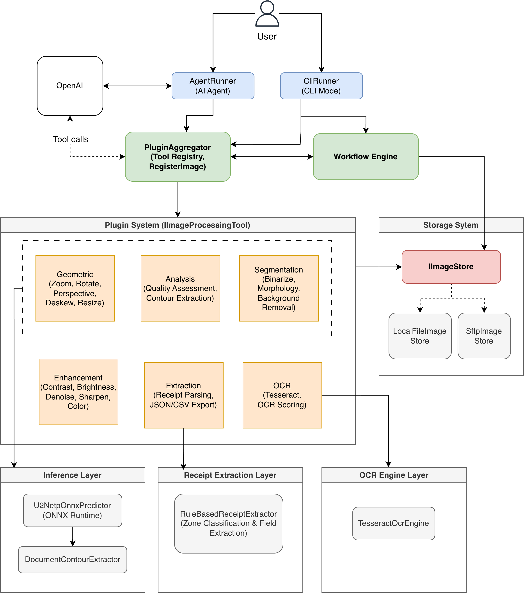

# System Architecture

## Architecture Diagram



## System Components

### 1. Storage Layer

**IImageStore Interface**
- Abstracts storage operations for cross-backend compatibility
- Supports save, load, exists, metadata operations
- Tracks image lineage through parent references
- Subdirectory scoping for workflow-isolated writes

**LocalFileImageStore**
- Default filesystem-based storage (`./local-storage`)
- Saves images with JSON sidecar metadata
- Read fallback to root when active subdirectory is set

**SftpImageStore**
- Remote SFTP storage via SSH.NET
- Connection pooling (1–10 connections, configurable)
- Automatic retry with exponential backoff (3 retries, 100ms initial, 2x multiplier)
- Health monitoring and metrics tracking (`SftpHealthMonitor`)
- Downloads to temp files for plugin access

**StorageFactory**
- Reads `Storage:Provider` from config and creates the appropriate backend
- Falls back to `SFTP_PASSWORD` environment variable when password is not in config

### 2. Plugin System

All image processing operations implement the `IImageProcessingTool` interface and are registered in `PluginAggregator`.

**Analysis** (`OcrAgent/Plugins/Analysis/`)
- `QualityAssessmentPlugin` — blur, noise, brightness, contrast, skew, resolution scoring
- `ContourExtractionPlugin` — U2-Net + contour detection for document boundaries

**Geometric** (`OcrAgent/Plugins/Geometric/`)
- `AutoOrientPlugin` — fix 90/180/270 rotations via OSD
- `PerspectivePlugin` — correct perspective using U2-Net contours or classical fallback
- `DeskewPlugin` — Hough line-based fine-angle correction
- `ResizePlugin` — DPI-aware resizing with document-type presets
- `AutoCropPlugin` — trim whitespace to document edges
- `BorderPaddingPlugin` — add white/black border (Tesseract requires borders)
- `ZoomInPlugin` — zoom into regions with start/end/step ranges
- `RotatePlugin` — rotate by specified angles

**Enhancement** (`OcrAgent/Plugins/Enhancement/`)
- `ContrastPlugin` — auto, histogram equalization, CLAHE
- `BrightnessPlugin` — range-based brightness adjustment
- `DenoisePlugin` — bilateral, median, non-local means filtering
- `SharpenPlugin` — unsharp mask sharpening
- `ColorCorrectionPlugin` — auto, gray world, white patch
- `InvertPlugin` — automatic dark-background detection and inversion
- `IlluminationNormalizePlugin` — shadow and uneven lighting correction

**Segmentation** (`OcrAgent/Plugins/Segmentation/`)
- `BinarizePlugin` — Otsu, adaptive mean, adaptive Gaussian, Sauvola
- `MorphologyPlugin` — open, close, erode, dilate, gradient
- `DocumentBackgroundRemovalPlugin` — U2-Net foreground segmentation with multi-strategy fallback

**OCR** (`OcrAgent/Plugins/Ocr/`)
- `OcrPlugin` — Tesseract OCR with multi-variant binarization and multi-PSM selection
- `OcrScoringPlugin` — confidence, word count, keyword, and density scoring

**Extraction** (`OcrAgent/Plugins/Extraction/`)
- `ParseReceiptPlugin` — rule-based receipt parsing with zone classification
- `ExportReceiptPlugin` — export structured data to JSON and CSV

### 3. User Interface Layer

**AgentRunner (Chat Mode)**
- Interactive conversation loop with GPT-4o-mini via Microsoft.Agents.AI SDK
- Streaming token output for real-time feedback
- LLM selects and invokes tools based on user intent
- System prompt lists all 28 tool signatures with parameter descriptions

**CliRunner (CLI Mode)**
- Non-interactive command execution: workflows, tool calls, image registration, listings
- Invokes tools directly through `ToolBindingRegistry` without LLM
- Auto-registers file paths as uppercase reference IDs

### 4. Orchestration Layer

**PluginAggregator**
- Instantiates all plugins and binds them as AI-callable `AIFunction` objects
- Exposes `RegisterImage`, all plugin tools, and workflow tools
- Wires the `WorkflowTool` to the workflow engine at startup
- Maintains a `ToolBindingRegistry` for name-to-function lookup

### 5. Workflow Engine

**WorkflowCatalog** — loads `*.json` definitions from `Workflows/Definitions/`

**WorkflowCompiler** — compiles a definition into an executor graph; filters disabled steps and missing tools

**WorkflowRunner** — executes compiled workflows with per-run scoped storage directories (`wf_{id}/{runId}/`), collects step trace and timing

**ToolStepExecutor** — invokes a single tool, resolves `$context.*` arguments, writes optional outputs to context

**BranchDispatcherExecutor** — reads a context variable and dispatches to the matching branch

**Workflow Definitions:**
- `receipt_preprocess_v1` — preprocessing-only pipeline
- `receipt_extract_v1` / `v2` / `v3` — full extraction workflows with multi-variant OCR

### 6. OCR Engine

**TesseractOcrEngine**
- In-process Tesseract 5 via the `Tesseract` NuGet package
- Configurable `tessdata` path with auto-discovery fallback
- Per-word bounding box extraction with confidence scores
- Automatic macOS arm64 native library resolution

### 7. Inference Layer

**U2NetpOnnxPredictor**
- Loads U2NETP ONNX model for foreground segmentation
- Produces probability masks at 320×320 resolution
- Shared across plugins (loaded once at startup)

**DocumentContourExtractor**
- Converts probability masks to binary document masks
- Extracts 4-corner quadrilaterals with MinAreaRect fallback
- Returns confidence score for detection quality

### 8. Extraction Pipeline

**RuleBasedReceiptExtractor**
- `OcrTokenNormalizer` — fixes common OCR misreads and normalizes whitespace
- `ZoneClassifier` — divides lines into header, body, totals, footer by Y-coordinate
- `MerchantFieldExtractor`, `DateTimeFieldExtractor`, `LineItemFieldExtractor`, `TotalsFieldExtractor`
- `ReceiptValidator` — checks subtotal + tax = total consistency
- Overall confidence scoring

**Exporters:**
- `ReceiptJsonExporter` — structured JSON output
- `ReceiptCsvExporter` — tabular CSV output

## Data Flow

**Chat Mode:**
1. User sends a natural language prompt
2. AgentRunner forwards it to GPT-4o-mini
3. LLM selects and calls tools from the plugin registry
4. Plugin loads image from storage, processes it, saves output with metadata sidecar
5. Result returned to LLM, which formats a response

**CLI Mode:**
1. User runs a command with tool name or workflow ID
2. CliRunner invokes the tool directly or triggers the workflow engine
3. Results printed to console

**Workflow Execution:**
1. WorkflowRunner loads definition from catalog and compiles it
2. Each step's executor invokes the corresponding plugin through the tool registry
3. Step output reference becomes the next step's input
4. WorkflowContext carries inter-step data (quality profile, contour data, OCR text)
5. Final result with trace, timing, and context returned to caller

## Project Structure

```
.
├── OcrAgent/
│   ├── Agent/
│   │   ├── AgentRunner.cs              # AI agent chat mode
│   │   └── CliRunner.cs                # CLI command mode
│   ├── Inference/
│   │   ├── U2NetpOnnxPredictor.cs      # U2-Net ONNX model runner
│   │   └── DocumentContourExtractor.cs # Mask-to-contour post-processing
│   ├── Ocr/
│   │   ├── TesseractOcrEngine.cs       # Tesseract wrapper
│   │   ├── IOcrEngine.cs               # Engine interface
│   │   └── OcrResult.cs                # OCR output model
│   ├── Extraction/
│   │   ├── RuleBased/                  # Zone classifiers and field extractors
│   │   └── Models/                     # ReceiptData, LineItem DTOs
│   ├── Plugins/
│   │   ├── Analysis/                   # Quality assessment, contour extraction
│   │   ├── Geometric/                  # Perspective, deskew, resize, crop, orient
│   │   ├── Enhancement/                # Contrast, brightness, denoise, sharpen
│   │   ├── Segmentation/              # Binarize, morphology, background removal
│   │   ├── Ocr/                        # OCR and scoring plugins
│   │   ├── Extraction/                 # Receipt parsing and export
│   │   ├── IImageProcessingTool.cs     # Plugin interface
│   │   ├── PluginAggregator.cs         # Central tool registry
│   │   └── PluginHelpers.cs            # Shared utilities
│   ├── Storage/
│   │   ├── IImageStore.cs              # Storage interface
│   │   ├── LocalFileImageStore.cs      # Local filesystem backend
│   │   ├── SftpImageStore.cs           # SFTP remote backend
│   │   ├── SftpConnectionPool.cs       # Connection pooling
│   │   ├── SftpHealthMonitor.cs        # Health metrics
│   │   ├── StorageConfiguration.cs     # Config models
│   │   └── StorageFactory.cs           # Provider selection
│   ├── Workflows/
│   │   ├── Definitions/                # JSON workflow files
│   │   ├── Engine/                     # Catalog, compiler, runner, context
│   │   ├── Executors/                  # ToolStep and BranchDispatcher
│   │   ├── Model/                      # WorkflowDefinition, WorkflowStep, etc.
│   │   └── Tools/                      # WorkflowTool (AI-callable facade)
│   ├── Assets/
│   │   ├── Models/                     # ONNX model files
│   │   └── tessdata/                   # Tesseract language data
│   ├── appsettings.json
│   └── Program.cs                      # Entry point
├── UnitTests/
│   ├── Plugins/                        # Per-plugin test classes
│   ├── Workflows/                      # Engine, compiler, context tests
│   ├── Storage/                        # Local and SFTP backend tests
│   ├── Inference/                      # U2-Net and contour extractor tests
│   ├── Ocr/                            # OCR model serialization tests
│   └── IntegrationTests.cs             # Cross-component tests
├── Documentation/
│   ├── README.md
│   ├── SYSTEM_ARCHITECTURE.md          # This file
│   ├── CLI_USAGE.md                    # CLI command reference
│   └── SFTP_STORAGE.md                 # SFTP configuration guide
├── samples/                            # Sample receipt images
├── docker/sftp/                        # Local SFTP test server
├── .env.example                        # Environment variable template
└── OcrAgent.sln
```

## Advanced Features

### U2-Net Background Removal

1. U2NETP ONNX model produces a pixel-level foreground probability mask
2. Fallback to multi-strategy classical methods if model is unavailable (Otsu, HSV filtering, edge detection, GrabCut)
3. Output modes: white background, mask only, or transparent PNG

### SFTP Connection Pooling

- Thread-safe pool with configurable min/max connections
- Idle connection cleanup and keep-alive intervals
- Health monitoring with per-operation metrics
- Automatic retry with exponential backoff on connection failures

### Perspective Correction

1. U2-Net contour detection for document boundary
2. Classical edge detection fallback
3. Homography-based perspective warp to rectangular output
4. Handles documents that touch image borders

### Multi-Variant OCR

1. Four binarization variants: natural grayscale, Otsu, adaptive Gaussian, Sauvola
2. Two page segmentation modes: SingleColumn (PSM 4) and SingleBlock (PSM 6)
3. Up to 8 OCR candidates scored by confidence, word count, keywords, and text density
4. Budget-capped variant count from workflow definition
