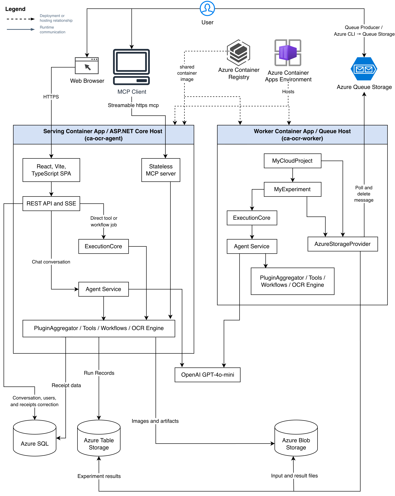
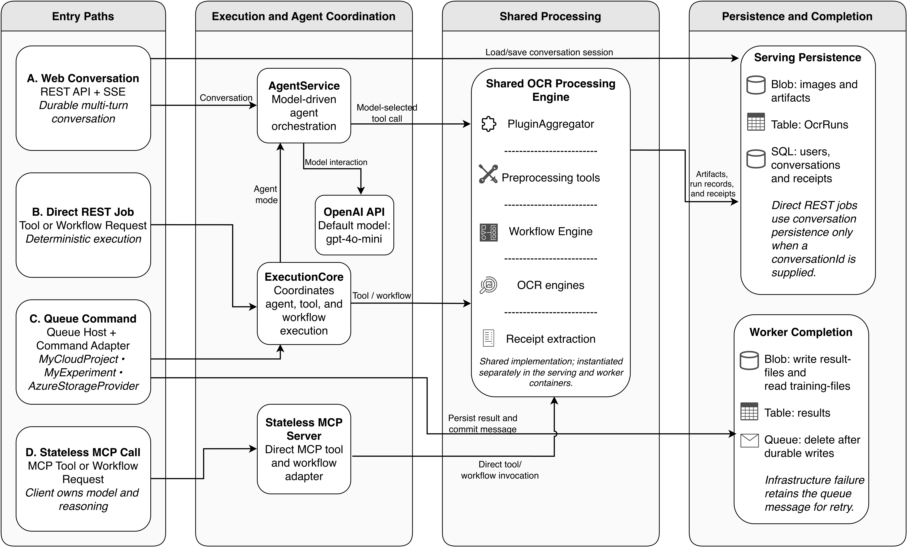

# Cloud-Native OCR Preprocessing Agent

This project turns receipt photographs into OCR-ready images and structured receipt data. It extends
the original console-based `OcrAgent` with a stateless Model Context Protocol (MCP) server, a REST
API, a React Web UI, durable cloud storage, and a queue-triggered course path.

The processing engine remains shared by every entry point. It provides image analysis, geometric
correction, enhancement, segmentation, Tesseract OCR, rule-based receipt extraction, and
declarative JSON workflows. U2NETP supplies document masks when its prediction is suitable, with
classical image-processing fallbacks for other inputs.

## Live deployment

- **Web UI:** https://ca-ocr-agent.blackglacier-c262b0d9.germanywestcentral.azurecontainerapps.io/
- **MCP endpoint:** https://ca-ocr-agent.blackglacier-c262b0d9.germanywestcentral.azurecontainerapps.io/

The Web UI and stateless MCP server share the same HTTPS origin and serving Container App.

## Architecture

The deployment view shows the public clients, the two Azure Container Apps, the external model
service, and the persistence services used by the serving and worker roles.



The component view distinguishes the four entry paths and shows how their path-specific adapters
reuse the shared OCR processing implementation. Direct REST and MCP requests invoke deterministic
tools or workflows without a server-side model call. Web conversations and queue commands use
`AgentService`, while only direct REST jobs and queue commands pass through `ExecutionCore`.



See [System Architecture](Documentation/SYSTEM_ARCHITECTURE.md) for detailed component boundaries,
runtime flows, and persistence responsibilities.

## Implemented access paths

- **Web UI:** upload images, stream agent responses, run workflows, inspect artifacts, edit receipt
  data, and reopen durable conversations.
- **REST API:** image upload, direct tool or workflow execution, Server-Sent Events (SSE), run
  history, artifacts, conversations, and receipt correction.
- **MCP:** stateless Streamable HTTP for remote clients and stdio for local clients. The MCP client
  supplies the model and calls the exposed tools or workflows directly.
- **CLI:** local tool, workflow, run-query, and console-chat commands.
- **Queue worker:** plain-language Azure Queue messages handle single images and queue-only bulk
  datasets. For example, `Remove background from all images in cord-smoke` plans once and fans out
  deterministic per-image work.

The Web UI calls REST, not MCP. The server-side agent is used by REST chat and the queue worker; it
is intentionally not wrapped in an `agent_chat` MCP tool.

Bulk sources follow `training-files/images/<dataset-name>/`. At parent planning, AI selects and
validates either one ordered image-transform tool chain or one workflow, then persists it as
`PlanJson`. Stable child messages reuse that plan without per-image AI. Stable batch/item IDs,
existing-result skips, a default 2,000-image cap, five dequeue attempts before `<queue>-poison`, and
one worker replica bound retry and duplication behavior. Child artifacts retain
`result-files/<group>/<item-id>/`.

The Web UI deliberately remains a single-image and conversation interface; the professor requested
bulk processing through the queue worker.

## Deployment shape

One Linux `amd64` image contains the Web UI, ASP.NET host, processing engine, native OCR
dependencies, and three roles selected by `entrypoint.sh`:

- `mcp` runs the Web UI, REST API, and MCP server on one HTTPS origin.
- `cli` runs console commands.
- `worker` starts the unchanged `MyCloudProject` queue loop.

Azure runs the serving and worker roles as separate Container Apps. The serving app has external
ingress and defaults to one to three replicas. The worker has no ingress and runs one replica.

The serving path uses Azure Blob Storage for images and artifacts, Azure Table Storage for run
records, and Azure SQL for conversations, users, receipts, line items, and correction revisions.
The course worker uses its configured Queue, `training-files`, `result-files`, and `results` Table
entities. It does not use the Web UI session database.

## Evaluation scope

This is an inference and orchestration system built from pretrained components; it does not train or
fine-tune U2NETP, Tesseract, or the language model. CORD contributes 1,000 receipt images under
CC BY 4.0 as an evaluation and robustness corpus, not learning artifacts. The `cord-smoke` subset is
for fast integration checks, while the full 1,000-image run is an optional benchmark. A deployed
two-image smoke batch verified parent planning, deterministic fan-out, child execution, Table rows,
and result Blob artifacts. The full CORD benchmark has not been run.

Accordingly, the project does not claim PR20 training compliance and will not train a model merely
to satisfy a dataset-size metric. The appropriate evidence is a reproducible bulk inference
evaluation with success, retry, throughput, artifact-integrity, OCR, and extraction measurements.

## Prerequisites

- Docker with Linux `amd64` build support
- .NET 10 SDK for local backend development
- Node.js 20 for frontend development
- An Azure Storage connection string for Blob, Table, and queue-backed scenarios
- An OpenAI API key for agent chat and queue commands
- Azure CLI for deployment and deployed verification

Tesseract, Leptonica, OpenCV, tessdata, and the U2NETP ONNX model are included in the container
build. A host installation is only needed when running the engine outside Docker.

## Quick start with Docker

Create the local configuration file:

```bash
cp .env.example .env
```

Set `OPENAI_API_KEY` to enable agent features. Configure Azure services only when they are needed;
the example file selects Azure providers for deployment. For a self-contained local run, set:

```dotenv
OCR_Storage__Provider=local
OCR_Runs__Provider=none
OCR_Sql__Enabled=false
```

Build and start the serving role directly with Docker:

```bash
docker build --platform linux/amd64 -t ocr-agent .
docker run --rm -p 5290:8080 --env-file .env ocr-agent
```

Alternatively, build and start the same role with Docker Compose:

```bash
docker compose up --build
```

Open `http://localhost:5290`. The same origin serves the SPA, `/api/*`, and MCP.

Check that the native OCR stack loaded:

```bash
docker run --rm ocr-agent cli list-tools | grep -E "RunOcr|ScoreOcrResult"
# Compose equivalent:
docker compose run --rm serving cli list-tools | grep -E "RunOcr|ScoreOcrResult"
```

Run a workflow against an image reference already present in the configured store:

```bash
docker run --rm --env-file .env ocr-agent \
  cli workflow receipt_extract_v3 RCPT001
# Compose equivalent:
docker compose run --rm serving cli workflow receipt_extract_v3 RCPT001
```

For a local image, mount its directory and register it first. Persistent local storage also needs a
mounted writable directory when separate container invocations must share the reference.

The queue worker is an opt-in Compose profile because it consumes the real Azure queue configured in
`.env`. Start it only when this side effect is intended:

```bash
docker compose --profile worker up --build worker
```

Use `docker compose down` to stop local services. This does not change Azure resources.

Container details and native dependency decisions are documented in
[CONTAINER.md](Documentation/CONTAINER.md).

## Local development

Build and test the .NET solution:

```bash
dotnet restore MyCloudProject.slnx
dotnet build MyCloudProject.slnx
dotnet test UnitTests/UnitTests.csproj
```

All six .NET projects target .NET 10 through `Directory.Build.props`. Build the Linux image with:

```bash
docker build --platform linux/amd64 -t ocr-agent .
```

Run the ASP.NET REST and MCP host:

```bash
dotnet run --project OcrAgent.Mcp/OcrAgent.Mcp.csproj
```

Run MCP over stdio:

```bash
dotnet run --project OcrAgent.Mcp/OcrAgent.Mcp.csproj -- --stdio
```

Run frontend checks:

```bash
cd web
npm ci
npm run test
npm run build
```

The production frontend is built and copied into the ASP.NET host by the Dockerfile. See
[WEBUI.md](Documentation/WEBUI.md) for the UI and REST contracts.

## Essential configuration

Configuration precedence is environment variables, `.env`,
`appsettings.{DOTNET_ENVIRONMENT}.json`, then `appsettings.json`. The main settings are:

- `OPENAI_API_KEY` and `OPENAI_CHATCOMPLETION_DEPLOYMENT`
- `OCR_Storage__Provider` (`local`, `azureblob`, or `sftp`)
- `AZURE_STORAGE_CONNECTION_STRING`
- `OCR_Runs__Provider` (`none` or `azuretable`)
- `OCR_Sql__Enabled` and `OCR_Sql__ConnectionString`
- `OCR_Auth__Enabled`, `OCR_Auth__Domain`, `OCR_Auth__ClientId`,
  `OCR_Auth__Audience`, `OCR_Auth__ScopeName`, and `OCR_Auth__ResourceUri`
- named `OCR_Auth__ApiKeys__Name` values containing SHA-256 hashes, never raw API keys
- `COURSE_STORAGE_CONNECTION_STRING` and the worker's `MyConfig__*` values

Secrets belong in `.env` for local work or Container Apps secret references in Azure. Raw API keys,
Auth0 Management API tokens, and other secrets must never be committed or built into the image. See
[CONFIGURATION.md](Documentation/CONFIGURATION.md) for the complete key list.

## Azure deployment and verification

The scripts use the existing `RG_Hidden_Layer` resource group and place new compute resources in the storage account's region.

```bash
scripts/azure-sql.sh               # when SQL is not already provisioned
export AUTH0_MANAGEMENT_API_TOKEN="<short-lived-token>"
python3 scripts/auth0-setup.py \
  --domain <tenant>.eu.auth0.com \
  --app-url https://<container-app-hostname>/
scripts/azure-deploy.sh
scripts/azure-worker-deploy.sh

scripts/azure-queue-produce.sh \
  --image SampleFiles/images/RCPT001.png \
  --message "Remove the background from RCPT001."

export OCR_AUTH_ACCESS_TOKEN="$(python3 scripts/auth0-token.py)"
scripts/verify-deployment.sh
python3 scripts/verify-webui.py https://<container-app-hostname>
python3 scripts/verify-queue-worker.py
```

`auth0-setup.py` creates or updates the Auth0 API, SPA, first-party native device client, strict open
Dynamic Client Registration (DCR), default third-party user grant, and Resource Parameter
Compatibility Profile. Its canonical `--app-url` becomes both the API audience and
`OCR_Auth__ResourceUri`, as required for MCP RFC 8707 resource parameters. Promote the Auth0
database, Google, and GitHub connections to the tenant domain for Universal Login. Unset the
short-lived Management API token after setup; never save or commit it.

`azure-deploy.sh` builds the Linux image in Azure Container Registry and creates or updates the
serving app. `azure-worker-deploy.sh` assigns that same image to the no-ingress worker. The scripts
do not create or delete the course resource group or storage account. The manual queue producer
uploads and enqueues but does not wait for results; the queue verifier performs that end-to-end
assertion.

See [DEPLOYMENT.md](Documentation/DEPLOYMENT.md) before creating, stopping, or removing Azure
resources.

## Project structure

```text
OcrAgent/              Processing engine, plugins, workflows, execution, stores, and CLI
OcrAgent.Mcp/          ASP.NET serving host for MCP, REST, SSE, and the compiled SPA
OcrAgent.Mcp.Tests/    Serving-host authentication and configuration tests
UnitTests/             Backend unit and integration tests
web/                   React, Vite, and TypeScript frontend
MyCloudProject/        Unchanged course queue host
MyCloudProject.Common/ Unchanged course contracts
MyExperiment/          Queue, Blob, Table, and experiment adapter
SampleFiles/           Queue-worker sample input
scripts/               Build, deployment, lifecycle, and verification scripts
Documentation/         Architecture and operational documentation
```

## Current limits

- Receipt extraction is rule-based and targets common English-language receipt layouts.
- OCR confidence is not field-level accuracy. The UI reports OCR confidence separately from
  consistency checks and correction status.
- In production, `/api` and `/mcp` require either an Auth0 JWT carrying `access:ocr` or a valid
  named `X-API-Key`. The static SPA, `/api/config`, and OAuth Protected Resource Metadata remain
  public so clients can start authentication. Local authentication can still be disabled explicitly
  for offline development.
- Auth0 protection is live and verified on the deployed Container App. Anonymous rejection,
  interactive Web login, MCP discovery, named API-key access, and authenticated REST/MCP workflows.
- Embeddings, vector similarity, duplicate detection, and an MCP receipt-query tool are future
  work.
- Secrets currently use Container Apps secret references. Azure Key Vault integration is not
  implemented.
- Queue bulk orchestration is live-verified with a two-image smoke batch. Full CORD benchmark and
  dataset-level OCR metrics remain evaluation work.

## Documentation

- [System Architecture](Documentation/SYSTEM_ARCHITECTURE.md)
- [Configuration](Documentation/CONFIGURATION.md)
- [Container](Documentation/CONTAINER.md)
- [Deployment](Documentation/DEPLOYMENT.md)
- [Web UI and REST API](Documentation/WEBUI.md)
- [MCP Client Testing](Documentation/MCP_CLIENT_TESTING.md)
- [Run Records](Documentation/RUN_RECORDS.md)
- [Queue Worker](Documentation/QUEUE_WORKER.md)
- [Experiment Specification](Documentation/Experiment%20Specification%20-%20Hidden%20Layer.md)
- [Reproducible Samples](SampleFiles/README.md)
- [AI Usage Log](Documentation/PROMPT.md)
- [Cloud Project Plan](Documentation/plans/CLOUD_PROJECT_PLAN_V1.md)

The `Documentation/SE_Course_*` files and previous paper describe the earlier console project. They
remain historical sources rather than current cloud setup instructions.
